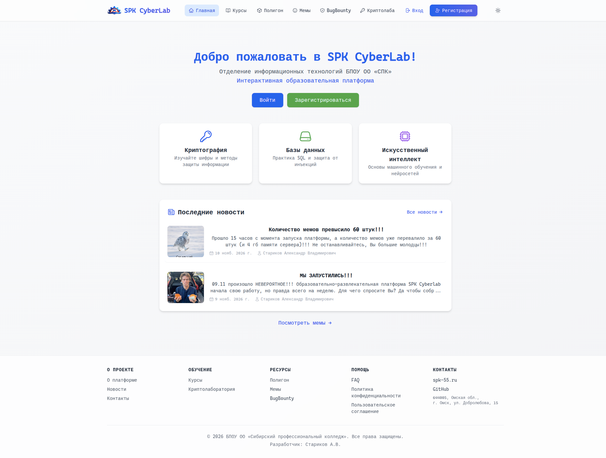
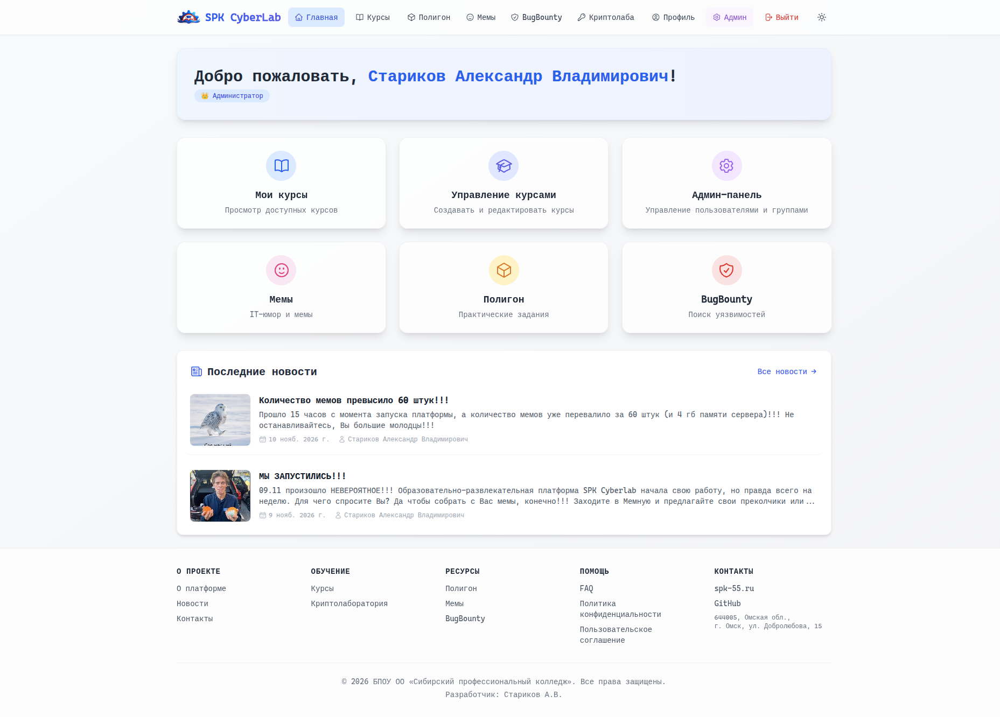
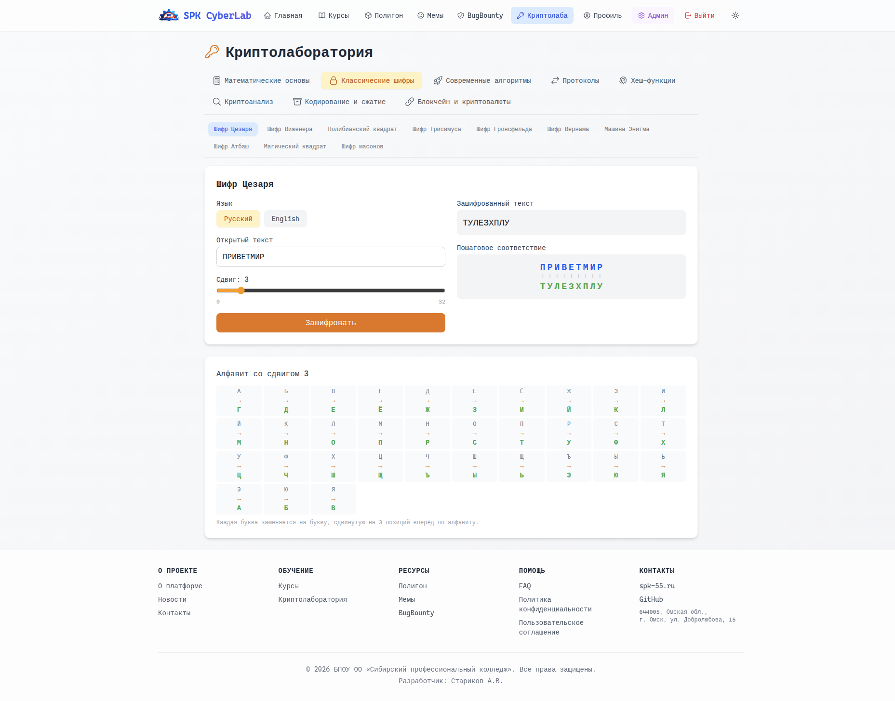

# [SPK CyberLab](https://spk-cyberlab.ru/)

[](https://opensource.org/licenses/MIT) [](https://github.com/AttackBeaver/spk-cyberlab.ru)

<p align="center">
  
</p>

SPK CyberLab — это интерактивная образовательная среда для изучения и развития практических навыков в IT. Разработана для студентов и преподавателей БПОУ ОО «Сибирский профессиональный колледж». Включает курсы с лекциями, полигон-песочницу для отработки SQL-инъекций и XSS, криптолабораторию с 35+ визуализациями алгоритмов, мемы с модерацией, Bug Bounty и полноценную админ-панель с аудитом действий.

**Год разработки:** 2026 · **Разработчик:** Стариков А.В.

## Ключевые возможности

| Модуль | Описание |
| ------ | -------- |
| **Аутентификация и роли** | Регистрация студентов по группе и номеру, автогенерация логина, вход по логину/паролю. Роли: Гость, Студент, Преподаватель, Администратор. |
| **Управление пользователями** | Создание групп, массовое добавление студентов (ручной ввод или CSV/Excel), создание преподавателей, каскадное удаление, сброс пароля. |
| **Курсы и лекции** | Структура «курс → лекции (PDF)». Drag‑and‑drop загрузка PDF, назначение групп. Лекции открываются прямо на платформе. |
| **Мемы** | Полный цикл модерации с soft-delete: «на модерации», «одобрен», «отклонён», «в корзине». Экспорт всех мемов в ZIP, топ-3 авторов, голосование лайками (дизлайки отключены). |
| **Новости** | CRUD с Markdown-редактором и предпросмотром, до 5 медиафайлов (изображения + видео) через drag‑and‑drop с изменением порядка, лайки, публичная страница, блок последних новостей на главной. |
| **Bug Bounty** | Отправка отчётов об ошибках, ответы администратора, управление статусами. |
| **Личный кабинет** | Профиль, статистика, достижения, смена пароля, история выполненных заданий. |
| **Геймификация** | Достижения (бейджи), таблица лидеров по заданиям и среднему баллу. |
| **Админ-панель** | Управление группами, студентами, преподавателями, курсами, новостями, Bug Bounty, мемами и журналом аудита. |
| **Полигон-песочница** | SQL-инъекции (in-memory SQLite), XSS и фишинг (в iframe), программирование на Python/JS с изоляцией в Docker. Конструктор заданий, отчёты, ручная проверка. |
| **Криптолаборатория** | 35+ интерактивных визуализаций: классические и современные шифры, хеши, протоколы, криптоанализ, кодирование, стеганография, блокчейн. |
| **Аудит-логи** | Централизованное журналирование всех значимых действий пользователей (вход, выход, мутации данных) с фильтрами и пагинацией. |

## Скриншоты

<details>
<summary><b>Главная страница</b></summary>



</details>

<details>
<summary><b>Криптолаборатория</b></summary>



</details>

<details>
<summary><b>Мемы</b></summary>


</details>

## Технологический стек

<table>
<tr>
<td valign="top" width="50%">

**Frontend**

- React 19
- TypeScript
- Vite
- Tailwind CSS
- React Router
- Axios
- React Dropzone
- React Markdown (+ remark-gfm)
- Headless UI
- Heroicons

</td>
<td valign="top" width="50%">

**Backend**

- Node.js 22
- Express
- TypeScript
- Prisma ORM
- JWT
- bcrypt
- Multer
- Dockerode
- Archiver

</td>
</tr>
<tr>
<td valign="top" width="50%">

**База данных**

- PostgreSQL 16 (нативно, без Docker в продакшене)

**Контейнеризация**

- Docker + Docker Compose (только для dev)

</td>
<td valign="top" width="50%">

**Инфраструктура**

- Хостинг: Timeweb.cloud (VPS)
- Процессный менеджер: PM2
- Веб-сервер: Nginx + SSL (Timeweb ProSSL)
- ОС: Ubuntu 24.04 LTS

</td>
</tr>
</table>

## Структура проекта

```txt
spk-cyberlab.ru/
├── backend/
│   ├── src/
│   │   ├── controllers/          # бизнес-логика
│   │   ├── routes/               # маршруты API
│   │   ├── middleware/           # аутентификация, роли, auditLog
│   │   ├── services/             # codeExecutor, sqlExecutor
│   │   ├── utils/                # Prisma, достижения, logger (аудит)
│   │   └── index.ts              # точка входа
│   ├── prisma/                   # схема БД + seed-скрипты
│   ├── uploads/                  # мемы, новости, лекции (не в git)
│   ├── sandbox-images/           # Docker-образы для изоляции (не в git)
│   └── package.json
├── frontend/
│   ├── src/
│   │   ├── pages/                # все страницы
│   │   │   ├── auth/             # Login, Register
│   │   │   ├── home/             # Home
│   │   │   ├── courses/          # Курсы
│   │   │   ├── admin/            # Админ-панель (+ вкладки «Мемы», «Логи»)
│   │   │   ├── sandbox/          # Полигон-песочница
│   │   │   ├── memes/            # Мемы
│   │   │   ├── news/             # Новости
│   │   │   ├── bugbounty/        # Bug Bounty
│   │   │   ├── profile/          # Профиль
│   │   │   ├── static/           # About, Contacts, FAQ, Privacy, Terms, 404, 500
│   │   │   └── CryptoLab/        # Криптолаборатория (30+ компонентов)
│   │   ├── components/           # Layout, LatestNews, NewsForm
│   │   ├── hooks/                # useAuth, useTheme
│   │   ├── services/             # api.ts (относительные пути /api)
│   │   ├── App.tsx
│   │   └── main.tsx
│   ├── public/                   # статика (логотип, favicon)
│   └── package.json
├── docs/
│   └── screenshots/              # скриншоты для README
├── docker-compose.yml            # только для разработки
└── README.md
```

## Что реализовано на текущий момент

### Ядро

- Полноценная аутентификация и ролевая модель (Гость / Студент / Преподаватель / Администратор).
- Регистрация студентов по группе и номеру с автогенерацией логина.
- Единый адаптивный макет с поддержкой тёмной/светлой темы.
- Относительные пути API (`/api`) — одинаково работает на dev и в prod.
- Каскадное удаление пользователей (все зависимые записи, кроме логов аудита).

### Админ-панель

- **Группы:** создание, удаление, добавление студентов (ручной ввод / CSV / Excel).
- **Студенты:** фильтр по группам, редактирование, сброс пароля, каскадное удаление.
- **Преподаватели:** создание, редактирование, сброс пароля, удаление.
- **Курсы:** создание, удаление, управление лекциями и группами.
- **Новости:** Markdown-редактор с вкладкой «Просмотр», до 5 медиафайлов (изображения + видео) через drag‑and‑drop с изменением порядка, удаление неиспользуемых файлов с диска при обновлении.
- **Bug Bounty:** ответы на отчёты, управление статусами, удаление.
- **Мемы:** полный цикл модерации (одобрить / отклонить / в корзину / восстановить / удалить навсегда), 5 табов со счётчиками, поиск, пагинация, экспорт в ZIP.
- **Логи:** журнал аудита с фильтрами (пользователь, действие, поиск по деталям, период) и пагинацией.

### Курсы и лекции

- Курсы с привязкой к группам.
- Лекции в формате PDF с drag‑and‑drop загрузкой.
- Управление курсом: добавление/удаление лекций, назначение групп.
- Просмотр PDF прямо на платформе.

### Полигон-песочница

- SQL-инъекции (in-memory SQLite, выполнение запросов, проверка).
- XSS и фишинг (макеты в iframe, авто-проверка).
- Программирование (Python и JavaScript в Docker-контейнерах).
- 15+ готовых шаблонов заданий, конструктор для преподавателей.
- Отчёты и ручная проверка, экспорт результатов в CSV, статистика.

### Мемы

- Загрузка изображений и видео (drag‑and‑drop).
- Модерация с soft-delete (отклонение и удаление обратимы, файлы не теряются).
- Корзина: восстановление или окончательное удаление (с файлом с диска).
- Экспорт ZIP: `memes.json` + `memes.csv` + `files/*` (streaming).
- Топ-3 авторов с медалями 🥇🥈🥉, голосование лайками.
- Категории, фильтрация, поиск, сортировка (по дате / популярности).
- Оптимизация: `preload="metadata"` для видео в сетке, lazy-loading картинок, быстрая модалка.

### Новости

- Markdown-контент: рендер на фронте через `react-markdown` + `remark-gfm`, без `dangerouslySetInnerHTML` (XSS исключён).
- Галерея до 5 медиафайлов на новость: изображения и видео, порядок через drag‑and‑drop (или стрелками), валидация размеров (изображения до 5 МБ, видео до 50 МБ).
- Лайки: toggle-голосование, денормализованный счётчик `News.likes`, batch-загрузка состояния через `/news/my-votes`.
- Legacy-поле `imageUrl` сохранено как fallback для старых новостей.
- Публичная страница `/news`: Markdown-рендер, галерея (1 крупная миниатюра / сетка), модалка просмотра (изображения и видео), управление с клавиатуры (Esc).
- Блок «Последние новости» на главной: превью первого медиа (▶ для видео), счётчик ❤, `stripMarkdown()` для чистого текста.
- Админ-форма на базе `NewsForm`: Markdown-редактор с предпросмотром, drag‑and‑drop нескольких медиа, при обновлении — diff-удаление файлов с диска.

### Аудит-логи

- Централизованная утилита `logAction` (не бросает исключений, обрезает `details` до 1000 символов).
- Middleware `auditLog` — автологирование всех `POST/PUT/PATCH/DELETE` (кроме `/api/auth/*`).
- Явное логирование `LOGIN`, `LOGIN_FAILED`, `LOGOUT`, `REGISTER`.
- IP из `X-Real-IP` → `X-Forwarded-For` → `req.ip`.
- Логи удалённых пользователей сохраняются (обнуляется `userId`).
- Индексы `userId`, `action`, `createdAt` — быстрая фильтрация.

### Криптолаборатория

- 35+ интерактивных визуализаций: классические шифры (Цезарь, Виженер, Полибианский квадрат, Трисимус, Гронсфельд, Вернам, Атбаш, масоны, магический квадрат, Энигма), современные (RSA, Эль-Гамаль, ГОСТ 28147-89, DES/Triple DES, AES, сети Фейстеля), хеш-функции, протоколы (Diffie-Hellman, ЭП, SSL/TLS), криптоанализ (частотный анализ, атака на поточный шифр, взлом RSA), кодирование (Base64, ASCII, CRC32), стеганография, визуализация блокчейна.
- Пошаговые визуализации, поддержка тёмной темы, адаптивный интерфейс.

## Обновления версий

### v1.4.1 — Новости: Markdown, мультимедиа и лайки

**Новости:**

- Модели `NewsVote` и `NewsMedia` (+ enum `NewsMediaType`), поле `News.likes` с индексом.
- Переработка `newsController`:
  - Markdown-контент (рендер на фронте через `react-markdown` + `remark-gfm`, XSS исключён).
  - Мультимедиа-галерея: до 5 файлов (изображения + видео), порядок через drag‑and‑drop.
  - Legacy-поле `imageUrl` сохранено как fallback для старых новостей.
  - Diff-удаление файлов с диска при обновлении, полная чистка при удалении.
  - `voteNews` — toggle-лайк, `getMyNewsVotes` — batch-состояние лайков одним запросом.
- Новый компонент `NewsForm`: Markdown-редактор с вкладкой «Просмотр», drag‑and‑drop загрузка нескольких медиа, reorder (стрелки + DnD), валидация размеров.
- Публичная страница `/news`: Markdown-рендер, галерея (1 крупная / сетка), модалка для просмотра изображений и видео, кнопка лайка с состояниями «гость / не лайкнул / лайкнул».
- `LatestNews` на главной: превью первого медиа (▶ для видео), счётчик лайков, `stripMarkdown()` для чистого текста.
- В админ-панели вкладка «Новости» переведена на `NewsForm` с изоляцией стейта через `key={editingNews?.id ?? 'new'}`.

**Мемы:**

- Дизлайки отключены в UI (модель и поле `Meme.dislikes` сохранены для совместимости).

**Инфраструктура:**

- Добавлены зависимости `react-markdown`, `remark-gfm`, `@tailwindcss/typography`.
- Проект переведён на локальный запуск стека в Docker (бэкенд `spk-backend` + БД `spk-db`).

### v1.4.0 — Аудит-логи и управление мемами

**Аудит-логи:**

- Таблица `Log` с индексами.
- Утилита `logAction` + константы `LogActions`.
- Middleware `auditLog` — авто-логирование мутаций.
- Явное логирование `LOGIN / LOGIN_FAILED / LOGOUT / REGISTER`.
- Вкладка «Логи» в админ-панели с фильтрами и пагинацией.
- При удалении пользователя логи сохраняются (обнуляется `userId`).

**Мемы:**

- Поля `rejectedAt`, `rejectedBy`, `deletedAt`, `deletedBy` + индексы.
- Полная переработка `memeController`:
  - `reject` — soft-reject.
  - `delete` — soft-delete в корзину.
  - `restore` — восстановление из корзины.
  - `hardDelete` — окончательное удаление (БД + файл).
  - `getAllMemesAdmin` — список со счётчиками.
  - `exportMemesZip` — streaming ZIP через `archiver`.
  - `voteMeme` — синхронизация `Meme.likes/dislikes` (фикс сортировки по популярности).
- Новая вкладка «Мемы» в админ-панели.
- Кнопка «Скачать ZIP» в админке и в режиме модерации.
- Топ-3 авторов с медалями, скрытые дизлайки, модалка для pending-мемов.
- Оптимизация производительности модалки и сетки.

### v1.3.4 — Криптолаборатория

35+ интерактивных визуализаций криптографических алгоритмов.

### v1.3.0 и ранее — Базовый функционал

Аутентификация, роли, курсы и лекции, полигон-песочница, мемы, новости, Bug Bounty, личный кабинет, достижения.

## Планы по развитию

- Наполнение платформы учебным контентом (курсы, лекции, PDF) по криптографии, БД, ИИ.
- Расширение полигона-песочницы (полноценная поддержка XSS, фишинга).
- Аналитика и статистика: графики прогресса, отчёты для преподавателей.
- Автоочистка логов по расписанию (cron, срок хранения 180/365 дней).
- Расширение системы достижений, введение уровней.
- Импорт студентов из Excel (уже частично через CSV).
- Горизонтальное масштабирование и дополнительные меры безопасности.
- CI/CD через GitHub Actions (автодеплой при пуше в `main`).
- Явное семантическое логирование в контроллерах (`COURSE_CREATE`, `MEME_LIKE`, `BUG_RESPOND`).

## Лицензия

Проект распространяется под лицензией **MIT**. См. [LICENSE](LICENSE).

## Контакты

**Разработчик:** Стариков Александр Владимирович  
Преподаватель БПОУ ОО «Сибирский профессиональный колледж»

© 2026 БПОУ ОО «Сибирский профессиональный колледж». Все права защищены.
